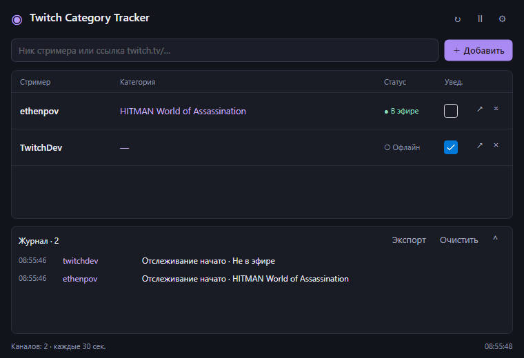

# Twitch Category Tracker

Компактная утилита для Windows, которая следит за категориями стримеров Twitch и уведомляет об изменениях.

## Скачать

**[Скачать v2.0.1 для Windows x64](https://github.com/wericool/Twitch-Category-Tracker/releases/download/v2.0.1/TwitchCategoryTracker-v2.0.1-win-x64.zip)** · [Все версии](https://github.com/wericool/Twitch-Category-Tracker/releases)

Распакуйте архив и запустите `TwitchCategoryTracker.exe`. Устанавливать .NET отдельно не нужно.



## Как пользоваться

1. Введите ник стримера или ссылку на его канал и нажмите **«Добавить»**.
2. Текущая категория и статус появятся в списке. Проверки начнутся автоматически.
3. В колонке **«Увед.»** можно отдельно включать и выключать уведомления каждого стримера.

Интервал проверки и общие настройки уведомлений находятся под кнопкой **⚙**. По умолчанию каналы проверяются каждые 30 секунд.

## Возможности

- Уведомления Windows о смене категории, начале и завершении эфира.
- Отдельный переключатель уведомлений для каждого канала. При отключении история продолжает записываться.
- Сворачиваемый журнал событий и экспорт в JSON.
- Работа в трее: кнопка сворачивания убирает окно с панели задач, двойной щелчок по значку возле часов возвращает его.
- Кнопка **«Пауза»** для остановки автоматических проверок.
- Сохранение списка каналов, настроек и истории между запусками.

Закрытие окна по умолчанию тоже оставляет утилиту работать в трее. Для полного завершения выберите **«Выход»** в меню значка.

## Где хранятся данные

В папке **`data` рядом с EXE**. Чтобы перенести утилиту вместе с настройками, копируйте и эту папку. Кнопка **«Папка данных»** открывает её в Проводнике.

Программа хранит последние 1000 событий и резервную копию предыдущего сохранения. Папка с программой должна быть доступна для записи.

## О работе с Twitch

Используется внутренний API сайта Twitch. Если Twitch изменит его, может потребоваться обновление утилиты. Изменения, которые произошли между двумя проверками, могут быть пропущены. При сбое сети последние полученные данные сохраняются и помечаются как устаревшие.

## Для разработчиков

Новая версия написана на **C# / .NET 10 и Avalonia**. Исходники находятся в [`modern`](modern); прежняя WinForms-версия сохранена в [`WindowsFormsApp10`](WindowsFormsApp10).

Для сборки нужен .NET 10 SDK:

```powershell
./build.ps1
```

Готовый EXE появится в `dist/TwitchCategoryTracker/`. Проверки, структура проекта и команды диагностики описаны в [документации разработчика](docs/DEVELOPMENT.md).

[История версий](CHANGELOG.md)
