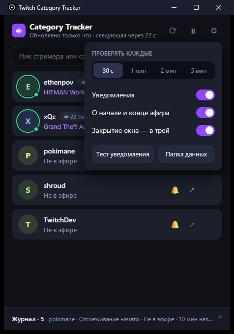

# Twitch Category Tracker

Маленькая утилита для Windows: следит за стримерами Twitch и присылает уведомление, когда они **сменили категорию**, вышли в эфир или закончили трансляцию. Без входа в аккаунт, без токенов.

[**⬇ Скачать для Windows**](https://github.com/wericool/Twitch-Category-Tracker/releases/latest) · один файл, **3,5 МБ**, установка не нужна


## Как пользоваться

1. Скачайте `TwitchCategoryTracker.exe` и запустите его.
2. Введите ник стримера или вставьте ссылку на канал, нажмите **Добавить**.
3. Всё. Утилита проверяет каналы сама и сообщает об изменениях. Окно можно закрыть: программа продолжит работать в трее.

Колокольчик 🔔 рядом со стримером включает или выключает уведомления только для него. Журнал внизу хранит последние события.



## Возможности

- Уведомления Windows о смене категории, начале и конце эфира.
- Живые стримеры сверху списка, с категорией и числом зрителей.
- Интервал проверки: 30 секунд, 1, 2 или 5 минут. Пауза в один клик.
- Журнал событий с экспортом в JSON.
- Работа в трее: закрытие окна оставляет утилиту работать, двойной щелчок по значку возвращает окно, **Выход** — в меню значка.
- Все данные лежат в папке `data` рядом с exe, так что программу можно носить с собой.

Данные из старой версии (C#) подхватываются автоматически.

## О работе с Twitch

Используется публичный (гостевой) интерфейс сайта Twitch. Если Twitch изменит его, может понадобиться обновление утилиты. Изменения между двумя проверками могут быть пропущены. При сбое сети последние данные сохраняются, а у канала появляется пометка.

Требуется WebView2 — он уже есть в Windows 10 и 11.

## Сборка

Нужны [Rust](https://rustup.rs) и Visual Studio Build Tools (C++).

```powershell
cd src-tauri
cargo test
cargo build --release --features custom-protocol
```

Результат: `src-tauri/target/release/twitch-category-tracker.exe`. Приложение написано на **Rust + Tauri 2**, интерфейс — один HTML-файл `ui/index.html`.

Предыдущие версии на C# (WinForms и Avalonia) остались в истории репозитория.